# Project Plan

## Metadata
| Key | Value |
| --- | --- |
| ID | PP-001 |
| CrossReference | [BC-001], [SA-001], [MIL-001], [MIL-002], [MIL-003], [MIL-004] |
| Language | en |
| Domain | it |

## Version History
| Date | Status | Author | Reviewer | Change | Commit |
| --- | --- | --- | --- | --- | --- |
| 2026-11-20 | Accepted | Jens Tirsvad Nielsen | S01 | Initial version; reviewed Go in RC-003, stand-in review, not independent | [d4bf2df] |

---

## Purpose

The plan schedules four phases (gateways) that take the Breakout clone from an empty repository to a documented, published solution. It follows the Business Case constraint of about two hours of build effort plus documentation ([BC-001]); the phases are dated one per day so that each ends in a reviewed pull request.

## Planning Assumptions

- The project starts on 2026-11-20 and ends by 2026-11-23, which fits the two-hour build effort plus documentation constraint of [BC-001] (source: the Business Case).
- One phase equals one branch and one pull request.
- The work runs in autonomous mode: S01 accepts this plan, and every later review is a stand-in review recorded as such ([SA-001], CR-001).
- Every task is a plain technical task. The game has one player and no persisted data, so no use case or design artifact is modelled; the milestone reviews check the code against the layers described in the tasks.

## Gateway Schedule

| Gateway | Document | Window | Decision date | Owner | Stories | Main deliverable | Milestone |
| --- | --- | --- | --- | --- | --- | --- | --- |
| G1 Foundation | [MIL-001] | 2026-11-20 | 2026-11-20 | S01 | none (technical tasks) | Repository set-up, project configuration, README, Doxyfile, tooling | |
| G2 Paddle and ball | [MIL-002] | 2026-11-21 | 2026-11-21 | S01 | none (technical tasks) | Steps 1 to 3 with tests and screenshots | |
| G3 Bricks and game | [MIL-003] | 2026-11-22 | 2026-11-22 | S01 | none (technical tasks) | Steps 4 to 7 with tests and screenshots | |
| G4 Wiki and release | [MIL-004] | 2026-11-23 | 2026-11-23 | S01 | none (technical tasks) | Wiki in three languages, reflection, final scan | |

```plantuml
@startgantt
Project starts 2026-11-20
[G1 Foundation] starts 2026-11-20 and ends 2026-11-20
[G1 Go/No-Go] happens 2026-11-20
[G2 Paddle and ball] starts 2026-11-21 and ends 2026-11-21
[G2 Go/No-Go] happens 2026-11-21
[G3 Bricks and game] starts 2026-11-22 and ends 2026-11-22
[G3 Go/No-Go] happens 2026-11-22
[G4 Wiki and release] starts 2026-11-23 and ends 2026-11-23
[G4 Go/No-Go] happens 2026-11-23
@endgantt
```



## Scope Coverage

| Business Case scope item | Gateway |
| --- | --- |
| Project set-up: pyproject, gitignore, editorconfig, constants, Doxyfile, README | G1 |
| Repository description and topics | G1 |
| Local security scan before each push | G1 (tooling), every gateway (use) |
| Window, paddle, ball, bounces (steps 1 to 3) | G2 |
| Tests with pytest for the game rules | G2, G3 |
| Bricks, brick removal, score, lives, win and game over, speed-up (steps 4 to 7) | G3 |
| Screenshots of each development step | G2 (steps 1 to 3), G3 (steps 4 to 7) |
| Wiki in English, Danish and Bahasa Malaysia | G4 |

## Dependencies

```
G1 Foundation → G2 Paddle and ball → G3 Bricks and game → G4 Wiki and release
```

A No-Go at a gateway stops the later gateways; the failed work is fixed and re-reviewed, and the later dates move by the same number of days. S01 decides any move of the end date (2026-11-23).

## Plan Risks

| Risk | Impact | Mitigation |
| --- | --- | --- |
| Screenshots need a container with a virtual display and it fails to build (from the Business Case risk that the Turtle window cannot be tested on the host) | G2 and G3 are late | Build the image in G1 and prove it with a blank-window screenshot |
| The wiki translation takes longer than planned | G4 slips | English is written first; the Danish and Malay pages follow the same page set |
| The git host API rejects the token scope (from the Business Case risk of a leaked token: the token is used only through the environment) | No description, topics or issues | Stop and report; the user supplies a token with the right scope |

## Open Issues

- Decision: no use cases are modelled, because every task is technical (one player, no stored data). S01 confirms this by accepting the plan.
- The PlantUML server setting in the registry is not set, so the Gantt chart is not rendered; the text follows the PlantUML Gantt syntax.
- The Tools table of the registry stays a placeholder until a PlantUML server is chosen.

---

[BC-001]: ./business-case.md
[SA-001]: ./stakeholder-analysis.md
[MIL-001]: ./milestones/mil-001-foundation.md
[MIL-002]: ./milestones/mil-002-steps-1-3-paddle-ball.md
[MIL-003]: ./milestones/mil-003-steps-4-7-bricks-game.md
[MIL-004]: ./milestones/mil-004-wiki-release.md
[d4bf2df]: https://git.tirsystem.com/Tirsvad-Udemy-100-days-of-code/087-assignment-breakout-game/commit/d4bf2df2d88712f1b4e71c76be15fb497ac94ed4
